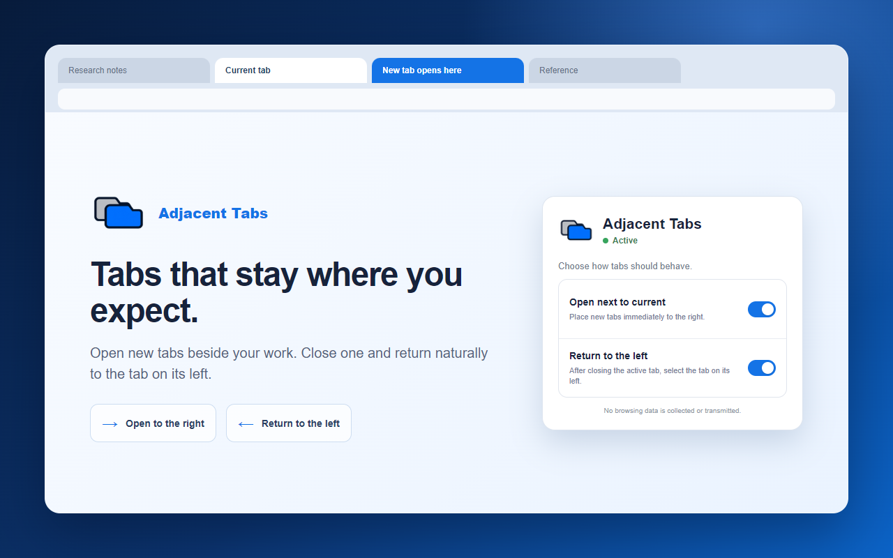

# Adjacent Tabs

Adjacent Tabs makes browser tab behavior simple and predictable.

## Features

- Places every new tab immediately to the right of the current tab.
- Activates the tab on the left after the current tab is closed.
- Lets users enable or disable either behavior from the toolbar popup.
- Handles each browser window independently.
- Keeps pinned tabs inside the browser's dedicated pinned-tab area.
- Includes English and Russian localization.

The extension does not read website content, collect browsing history, use
analytics, or transmit data. See the [privacy policy](PRIVACY.md) for details.

## Install for development

1. Download or clone this repository.
2. Open `browser://extensions` in Yandex Browser, or `chrome://extensions` in a
   Chromium-based browser.
3. Enable **Developer mode**.
4. Click **Load unpacked** and select the repository folder.

## Test

1. Open several tabs and select one in the middle.
2. Press `Ctrl+T`; the new tab should appear immediately to its right.
3. Press `Ctrl+W`; the tab to the left of the closed tab should become active.
4. Use the extension popup to disable either rule and verify that the browser's
   default behavior is restored for that rule.

## Privacy

Adjacent Tabs stores only two user preferences and temporary tab-order state in
the browser. Nothing is sent outside the user's device.

---

## Русский

Adjacent Tabs делает поведение вкладок простым и предсказуемым.

### Возможности

- Помещает каждую новую вкладку сразу справа от текущей.
- После закрытия активной вкладки выбирает вкладку слева.
- Позволяет независимо включать и выключать обе функции во всплывающем окне.
- Обрабатывает каждое окно браузера отдельно.
- Учитывает выделенную браузером область закреплённых вкладок.
- Поддерживает английский и русский языки.

Расширение не читает содержимое сайтов, не собирает историю посещений, не
использует аналитику и не передаёт данные. Подробности находятся в
[политике конфиденциальности](PRIVACY.md).

### Установка для разработки

1. Скачайте или клонируйте репозиторий.
2. Откройте `browser://extensions` в Яндекс Браузере или
   `chrome://extensions` в другом Chromium-браузере.
3. Включите **Режим разработчика**.
4. Нажмите **Загрузить распакованное расширение** и выберите папку репозитория.

### Проверка

1. Откройте несколько вкладок и выберите вкладку в середине.
2. Нажмите `Ctrl+T`: новая вкладка должна появиться сразу справа.
3. Нажмите `Ctrl+W`: активной должна стать вкладка слева от закрытой.
4. Отключите одно из правил во всплывающем окне и проверьте, что для него
   восстановилось стандартное поведение браузера.

## Version

Current version: `1.3.0`
